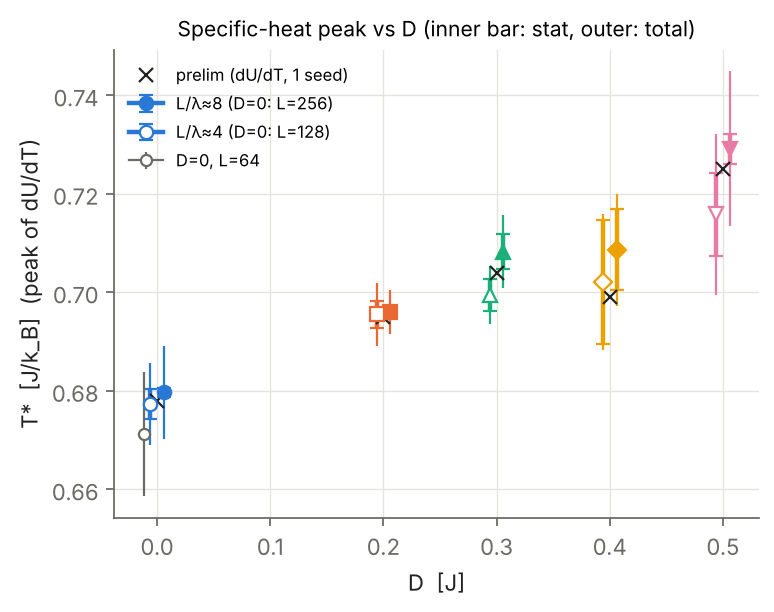
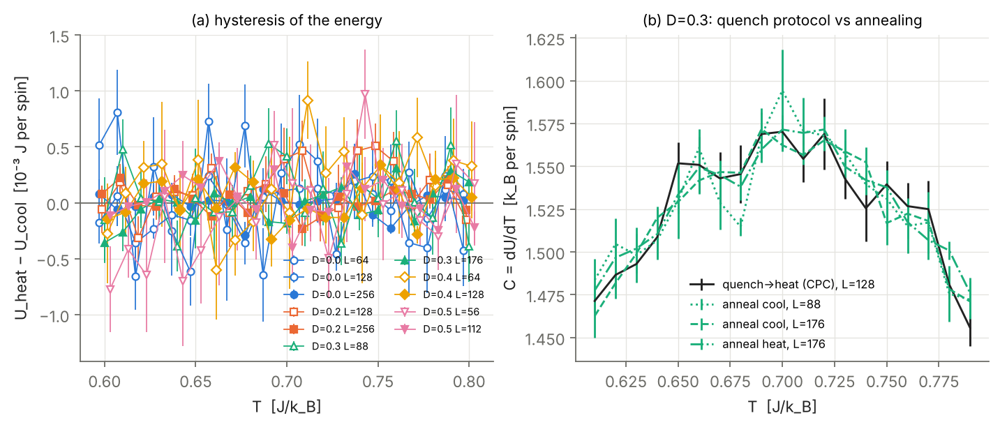
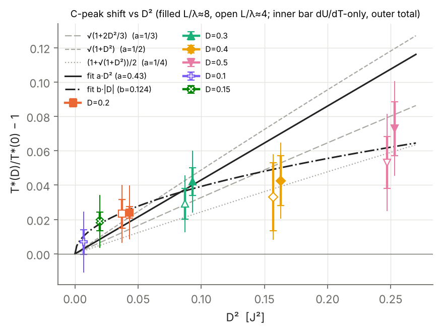
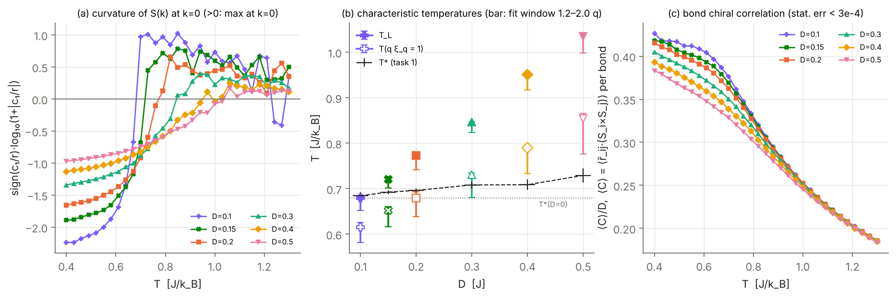

# 보고서: 2D 카이럴 자성체의 두 특성 온도와 VAE 질서변수

의뢰서: [REQUEST.md](REQUEST.md). 작업이 끝날 때마다 이 파일에 덧붙입니다.

## [R-1] 2026-11-21 · 작업 1 · 계산 계획과 예상 소요 시간 (착수 전 검토 요청)

상태: 계획만 확정, 본 계산 대기 중. [V-0]에 따라 검토 후 착수합니다.

### 1.0 계산 전 정리 (대칭과 해석적 어림)

- D=0: O(3) 대칭, 2D이므로 T>0에서 장거리 질서 없음(Mermin–Wagner). 상관 길이는 ξ ∝ exp(2πJ/T)로 자라며 열용량에는 특이점이 없는 교차 봉우리만 있습니다.
- D>0 (Bloch DMI, 정사각 격자): 스핀 회전 대칭은 격자 회전과 묶인 이산 대칭(C4v 꼴)으로 줄어들지만 나선 위상(병진)은 연속 대칭으로 남아 2D에서 T>0 장거리 나선 질서는 없습니다. 남을 수 있는 것은 나선 방향의 이산(Z2/Z4) 질서뿐이고, 이는 작업 4에서 다룹니다. 따라서 작업 1의 열용량 봉우리도 교차로 다룹니다.
- 저온 극한: 스핀당 자유도 2, 고전 등분배로 C → 1. 측정값(봉우리 1.6, 바탕 1.4)과 비교할 기준입니다.
- 규약 확인: `src/kernels.py`는 `prelim/tstar.py`와 같은 국소장 식(Bloch형, d_ij = r̂_ij)을 씁니다.

### 1.1 파일럿 (작은 계산으로 방향 확인)

`src/pilot_tau.py`: T* 근처 에너지의 적분 자기상관 시간 τ_int (스윕 = Metropolis 1 + 과완화 2).

| D | L | T | τ_int(E) [스윕] | C |
|---|---|---|---|---|
| 0 | 128 | 0.70 | 7.2 | 1.75 |
| 0.2 | 256 | 0.68 | 6.9 | 1.61 |
| 0.3 | 128 | 0.70 | 6.0 | 1.55 |
| 0.5 | 112 | 0.72 | 6.9 | 1.57 |

τ_int는 L과 D에 거의 무관하게 약 7 스윕입니다. 이로부터 정한 것:

- 측정 6,000 스윕 ≈ 독립 표본 430개. 요동식 C의 상대 통계 오차는 √(4τ/n) ≈ 7%이고 L에 따라 줄지 않습니다. 반면 U의 오차는 1/L로 줄어서, 큰 L에서는 dU/dT(유한 차분, 0.01 격자)가 요동식보다 정밀합니다. 두 추정량을 모두 쓰고, 다중 히스토그램 재가중도 겹침이 충분한 곳에서 씁니다.
- 0.01 간격에서 이웃 온도 간 에너지 히스토그램의 분리는 L=128에서 약 2σ, L=256에서 약 4.5σ입니다. 큰 L에서는 재가중의 겹침이 부족할 수 있어, 격자점 위의 직접 추정과 비교합니다.

### 1.2 본 계산 설계

`src/run_task1.py`

- 크기 (L/λ ≈ 4, 8): D=0: 64, 128, 256 · D=0.2 (λ=31.8): 128, 256 · D=0.3 (λ=21.6): 88, 176 · D=0.4 (λ=16.5): 64, 128 · D=0.5 (λ=13.6): 56, 112
- 씨앗 1–4.
- anneal 프로토콜: 무작위 → 1.00…0.85 예비 냉각 → 0.80→0.60 냉각 측정(0.01 간격) → 0.50까지 더 냉각 → 0.60→0.80 가열 측정.
- quench 프로토콜(CPC 논문 방식): D=0.3, L=128. T=0.1에서 2,000 스윕 급랭으로 미로 상태를 만든 뒤 같은 배치에서 각 온도로 바로 가열.
- 온도마다 평형 1,000 + 측정 6,000 스윕. 평형 구간을 포함해 매 스윕 에너지를 저장해 표류와 이력을 사후 점검합니다. 원시 시계열은 `data/raw/`(커밋 안 함)에 두고, 요약만 `data/`에 커밋합니다.

**예상 소요 시간**: 스핀·스윕당 약 170 ns(파일럿 실측). 실행 한 벌(anneal)이 약 30.5만 스윕이므로 L=256은 벌당 약 57분, L=128은 약 14분. 전체 48벌(quench 4벌 포함) ≈ 52,000 CPU초, 4코어 병렬로 **약 3.6시간**.

**경위**: 처음에는 이 계획대로 본 계산을 시작했습니다. 그런데 `REVIEW.md` [V-0]과 `CLAUDE.md`(이 브랜치를 만든 뒤 main에 올라옴)를 읽고, 시작 약 6분 만에 모두 중단했습니다. 미완성 출력은 지웠습니다. 지금까지 끝난 것은 1.1의 파일럿(4벌, 각 1분 정도)뿐입니다.

### 교수님 확인 필요

1.2의 계획에는 L=256 실행 12벌(각 약 57분)이 들어 있고, 전체는 4코어에서 약 3.6시간 걸립니다. `CLAUDE.md`의 "몇 시간 이상 걸리는 계산의 착수"에 해당하므로 다음 중 하나를 정해 주세요.

- **A (원안)**: 위 계획 전체. 약 3.6시간.
- **B (축소안)**: L=256을 빼고 D=0은 64, 128, D=0.2는 128만(L/λ ≈ 4). D=0.2의 L/λ ≈ 8은 작업 2(L ≥ 256)로 넘깁니다. 약 1.7시간.
- **C (단계안)**: B를 먼저 돌려 보고한 뒤, 검토를 받아 L=256을 추가합니다.

실행 세션의 추천은 C입니다. 작은 계에서 추정량 세 가지(요동식, dU/dT, 재가중)의 계통 오차 크기를 먼저 확인하면, L=256에 들일 씨앗 수와 스윕 수를 근거를 갖고 정할 수 있습니다.

## [R-2] 2026-11-21 · 작업 1 · 본 계산 착수, H1 판정 기준 (결과 보기 전에 정함)

상태: 계산 진행 중. [V-1]에 따라 A안(48벌, 약 3.6시간)으로 착수했습니다.

### 반영 사항

- [V-1] 4번: `src/run_task1.py`에 저장 항목을 추가했습니다.
  - 모든 D: 각도 평균 전 S(k)를 |k_x|, |k_y| ≤ k_c 영역에서 저장합니다(파수 단위 2π/L). k_c는 6 이상이고, D>0이면 고리 반지름의 2배 이상입니다. D=0의 Ornstein–Zernike 맞춤에 씁니다.
  - D>0: 고리(0.6–1.5 n_q, n_q = L·√2·arctan(D/√2)/2π, `prelim/aniso.py`와 같은 정의)에서 S(k) 가중 ⟨cos4φ⟩와 |⟨e^{2iφ}⟩|를 저장합니다.
- [V-1] 3번: 세 추정량의 차이를 계통 오차로 따로 보고합니다. L=256에서 재가중 겹침(Kish 유효 표본 수)이 부족하면 그 추정량은 빼고, 뺐다고 적습니다.

### H1 판정 기준 (결과를 보기 전에 고정)

**T\*의 정의**

- 대표 추정량은 dU/dT입니다. 0.01 격자 위의 중심 차분에 반폭 0.04 창으로 2차식을 맞춰 봉우리를 찾습니다.
- 한 (D, L)의 T\*는 씨앗 4개 × 냉각·가열의 평균입니다.

**오차**

- σ_stat: 씨앗 간 표준편차/√n. 냉각과 가열을 따로 구한 뒤 평균합니다.
- σ_syst: 다음 세 항목을 제곱합으로 합칩니다.
  1. 추정량 간 반범위: dU/dT, 요동식, 재가중(쓸 수 있을 때)
  2. 창 반폭 0.03–0.05의 반범위
  3. 냉각·가열 차이의 절반
- σ = √(σ_stat² + σ_syst²)

**비교 쌍**

- 각 D>0은 L/λ ≈ 8인 큰 계를 씁니다.
- D=0과의 비교: D=0의 L=128과 L=256 차이가 오차 안이면 D=0 L=256을 기준으로 씁니다. 오차를 넘으면 같은 L끼리 비교합니다(D=0.2와 L=256, D=0.4와 L=128).
- 보조로 L/λ ≈ 4 계에서도 같은 판정을 하고, 두 결과가 다르면 그 사실을 보고합니다.

**판정**

- **지지**: 모든 D ∈ {0.2, 0.3, 0.4, 0.5}에서 |T\*(D) − T\*(0)| ≤ 2√(σ_D² + σ_0²)이고, T\*(D)의 직선 맞춤 기울기가 0에서 2σ 이내.
- **기각**: 어느 D에서든 차이가 3√(σ_D² + σ_0²)를 넘거나, 기울기가 0에서 3σ 넘게 벗어남.
- **미결**: 그 밖의 경우.
- 참고: 예비 결과의 dU/dT 값(0.678–0.725)은 차이가 최대 0.047이고, 4절에 적힌 계통 오차는 약 0.02입니다.

## [R-3] 2026-11-21 · 작업 1 · 열용량 봉우리 T\*: D=0에도 있으나 D에 따라 약간 오름. H1 판정은 미결

상태: 작업 1 완료(48벌). 판정은 [R-2]에서 미리 정한 기준을 그대로 적용했습니다.

### 실행 기록

- **48벌 모두 완료**: anneal 44벌(5개 D × 크기 2–3 × 씨앗 4), quench 4벌.
- **컨테이너 재시작**: 계산 도중 컨테이너가 두 번 재시작됐습니다.
  - 그 뒤로 `src/run_task1.py`는 온도 단계마다 체크포인트를 저장하고, `src/queue_task1.sh`는 끝난 벌을 건너뜁니다.
  - 재시작 시점에 미완성이던 벌은 처음부터 다시 돌렸습니다. 단계 중간에서 이어 돈 벌은 없습니다.
  - 재개 기능을 쓰면 numba 난수 상태를 복원할 수 없어 (씨앗, 단계 번호)로 다시 씨앗을 넣습니다. 그러면 같은 씨앗이라도 끊기지 않은 실행과 비트 단위로 같은 결과가 나오지는 않습니다.
- **실측 소요 시간**: 약 4.5시간(재시작 손실 포함). 예상은 3.6시간이었습니다.
- **재현 절차**: `src/queue_task1.sh` → `src/analyze_task1.py` → `src/summarize_task1.py` → `src/judge_h1.py` → `figures/fig_t1_*.py`
- **커밋한 요약**: `data/task1_summary.json`(벌 종류별 T\*와 씨앗 평균 곡선), `data/task1_h1.json`(판정 수치). 원시 에너지 시계열(`data/raw/`, 약 0.5 GB)은 커밋하지 않았습니다.

### 결과 1: T\* 표 (dU/dT 봉우리, 씨앗 4개 × 냉각·가열 평균)

| D | L | L/λ | T\* | σ_stat | σ_추정량 | σ_창 | σ_이력 | σ_합 |
|---|---|---|---|---|---|---|---|---|
| 0 | 64 | — | 0.6712 | 0.0072 | 0.0040 | 0.0026 | 0.0092 | 0.0126 |
| 0 | 128 | — | 0.6773 | 0.0030 | 0.0075 | 0.0020 | 0.0002 | 0.0083 |
| 0 | 256 | — | **0.6797** | 0.0008 | 0.0093 | 0.0004 | 0.0012 | 0.0094 |
| 0.2 | 128 | 4.0 | 0.6955 | 0.0027 | 0.0031 | 0.0011 | 0.0047 | 0.0063 |
| 0.2 | 256 | 8.1 | **0.6961** | 0.0009 | 0.0041 | 0.0015 | 0.0001 | 0.0044 |
| 0.3 | 88 | 4.1 | 0.6995 | 0.0032 | 0.0012 | 0.0035 | 0.0033 | 0.0059 |
| 0.3 | 176 | 8.1 | **0.7083** | 0.0035 | 0.0052 | 0.0019 | 0.0035 | 0.0074 |
| 0.4 | 64 | 3.9 | 0.7022 | 0.0126 | 0.0035 | 0.0013 | 0.0042 | 0.0138 |
| 0.4 | 128 | 7.8 | **0.7086** | 0.0082 | 0.0060 | 0.0008 | 0.0051 | 0.0114 |
| 0.5 | 56 | 4.1 | 0.7158 | 0.0084 | 0.0129 | 0.0057 | 0.0008 | 0.0164 |
| 0.5 | 112 | 8.2 | **0.7292** | 0.0030 | 0.0118 | 0.0074 | 0.0067 | 0.0158 |

오차 산출 방법 ([R-2]에서 정한 대로):

- **σ_stat (통계)**: 씨앗 간 표준편차/√4를 냉각과 가열에서 따로 구해 평균했습니다. 씨앗이 4개뿐이라 이 값 자체가 약 40% 불확실합니다.
- **계통 오차 세 항목**:
  - σ_추정량: dU/dT, 요동식, 재가중 T\*의 반범위
  - σ_창: 맞춤 창 반폭 0.03–0.05의 반범위
  - σ_이력: 냉각과 가열 T\* 차이의 절반
- **σ_합**: 위 네 항목의 제곱합의 제곱근
- **재가중 사용 여부**: 모든 벌에서 Kish 유효 표본 수가 50 이상이어서 재가중을 빼지 않았습니다. 최솟값은 L=256에서 약 170입니다.

그림: [figures/fig_t1_Tstar.png](figures/fig_t1_Tstar.png) (T\* 대 D), [figures/fig_t1_C.png](figures/fig_t1_C.png) (C(T) 곡선)




### 결과 2: 예비 결과와 비교

| D | 예비 (dU/dT, 씨앗 1) | 이번 (같은 L 또는 L/λ≈8) |
|---|---|---|
| 0 | 0.678 (L=128) | 0.677 ± 0.008 (L=128), 0.680 ± 0.009 (L=256) |
| 0.2 | 0.695 (L=128) | 0.696 ± 0.006 (L=128) |
| 0.3 | 0.704 (L=96) | 0.700 ± 0.006 (L=88), 0.708 ± 0.007 (L=176) |
| 0.4 | 0.699 (L=64) | 0.702 ± 0.014 (L=64) |
| 0.5 | 0.725 (L=64) | 0.716 ± 0.016 (L=56), 0.729 ± 0.016 (L=112) |

- 예비 결과의 dU/dT 값은 모두 오차 안에서 재현됩니다.
- 예비 계산에 적힌 "6차 다항식에서 오는 계통 오차 0.02"는 과대평가였습니다. 0.01 격자에서 직접 구하면 창에 따른 차이가 0.001–0.007입니다.
- 예비 결과 표의 "T\*(요동)" 값(0.707–0.747)은 요동식 추정량의 큰 잡음(아래 결과 4) 때문에 흔들린 것으로 보입니다.

### 결과 3: 이력과 프로토콜

- **이력 없음**: 냉각과 가열의 U(T) 차이는 모든 (D, L)에서 0과 맞습니다. 그림: [figures/fig_t1_hysteresis.png](figures/fig_t1_hysteresis.png) (a).
  - 231개 점의 χ²/n = 1.43입니다. 오차가 씨앗 4개의 표준오차라 t 분포(자유도 3)를 따르므로, 기댓값은 1이 아니라 3입니다.
  - 평균 차이는 스핀당 |ΔU| ≲ 10⁻⁴입니다.
  - T\*의 냉각·가열 차이도 최대 0.013(D=0.5, L=112)으로 σ_합 안입니다.
- **급랭 프로토콜(CPC 논문 방식)**: D=0.3, L=128에서 T\* = 0.7046 ± 0.0015(통계) ± 0.010(창)입니다. 같은 D의 냉각 결과 0.6995(L=88), 0.7083(L=176)과 맞습니다. C(T) 곡선도 겹칩니다. 그림 (b).
  - 이 온도 영역(ξ ≲ 10)에서는 급랭으로 만든 미로가 1,000 스윕 안에 풀려, 급랭 프로토콜이 결과를 바꾸지 않습니다.
  - 단, 논문의 평형 스윕 수는 모르므로 더 짧은 평형에서도 같은지는 확인하지 않았습니다.



### 결과 4: 추정량 비교 ([V-1] 3번)

- **dU/dT**: L이 커질수록 정밀해집니다. L=256에서 씨앗 간 흩어짐이 0.002입니다.
- **요동식과 재가중**: 둘 다 요동식 C의 상대 잡음(온도점당 약 7%)을 물려받습니다. 한 벌의 T\*가 0.61–0.76 사이를 오가고, L이 커져도 나아지지 않습니다.
- 재가중은 겹침이 충분해 유효 표본 수에는 문제가 없지만, 정보량이 요동식과 같으므로 정밀도도 같습니다.
- 그 결과 σ_추정량(0.003–0.013)은 대부분 요동식과 재가중의 통계 잡음입니다. 이 추정량들이 계통적으로 어긋난다는 증거는 없습니다(아래 "판정 기준의 문제" 참고).

### H1 판정 (사전 기준)

**주 판정**: D>0은 L/λ≈8, 기준은 D=0의 L=256. D=0의 L=128과 L=256 차이는 0.0024로 결합 오차 0.013보다 작아 기준으로 L=256을 썼습니다.

| D | ΔT\* = T\*(D) − T\*(0) | 결합 σ | z |
|---|---|---|---|
| 0.2 | +0.016 | 0.010 | 1.6 |
| 0.3 | +0.029 | 0.012 | 2.4 |
| 0.4 | +0.029 | 0.015 | 2.0 |
| 0.5 | +0.050 | 0.018 | 2.7 |

- 기울기: dT\*/dD = 0.094 ± 0.041 (z = 2.3, D>0 네 점). D=0을 포함하면 0.090 ± 0.028 (z = 3.2).
- 사전 기준에서 기울기는 D>0 네 점으로 맞추므로 z = 2.3입니다. 기각선(3σ)은 넘지 않고 지지선(2σ)도 넘지 못해 **미결**입니다.

**보조 판정** (L/λ≈4): 차이의 z = 1.4, 1.8, 1.4, 1.9, 기울기 z = 1.1로 사전 기준상 "지지"입니다. 주 판정과 다릅니다.

**H1 판정: 미결.** H1을 두 부분으로 나누면 다음과 같습니다.

- **(a) 봉우리는 D=0에도 0.7J 근처에 있다: 지지.** D=0에서 T\* = 0.680 ± 0.009이고, 봉우리 모양도 D>0과 같습니다([fig_t1_C.png](figures/fig_t1_C.png)). 봉우리의 존재는 카이럴 구조와 무관합니다.
- **(b) 봉우리 위치는 D에 무관하다: 미결, 사후 분석으로는 기각 쪽.** D=0→0.5에서 T\*가 +0.050(7%) 오르고, 봉우리 높이는 1.67에서 1.48로 낮아집니다.
- 이번 크기 범위(L/λ ≈ 4→8)에서 T\*가 크게 움직이지 않으므로, 어느 판정에서든 T\*는 λ에 맞춰진 양으로 보이지 않습니다.

### 판정 기준의 문제 (검토 요청)

[R-2]의 기준은 σ_추정량을 계통 오차에 넣었습니다. 결과를 보니 이 항은 요동식과 재가중 추정량의 통계 잡음이고, 그래서 결합 오차가 부풀려집니다. 증거는 다음과 같습니다.

- 기울기 맞춤의 χ²/dof가 0.54/2로 1보다 훨씬 작습니다.
- dU/dT 하나만 쓰면 오차가 3–5배 작아집니다.

미리 정한 기준을 사후에 바꾸지 않으려고 판정은 "미결"로 두었습니다. 대신 아래 사후 분석을 따로 표시해 보고합니다.

### 사후 분석 (사전 기준 밖, 참고용)

1. **dU/dT만 쓴 경우**: σ에서 σ_추정량을 빼고 통계·창·이력만 넣었습니다(L/λ≈8).
   - ΔT\* = +0.016 ± 0.002 (z = 7.1), +0.029 ± 0.006 (5.2), +0.029 ± 0.010 (2.9), +0.050 ± 0.011 (4.7)
   - 이 오차로는 T\*가 D에 따라 오른다는 것이 뚜렷합니다.
2. **J_eff = √(J²+D²)로 척도를 맞춘 경우**:
   - 근거: 1D 사슬에서는 국소 스핀 회전으로 Bloch DMI가 J_eff = √(J²+D²)인 Heisenberg 결합으로 정확히 바뀝니다. 2D에서는 두 방향의 회전이 서로 교환되지 않아 정확하지 않습니다.
   - T\*/√(1+D²)와 D=0 L=256 값의 차이: D=0.2에서 +0.003 (z = 1.2), D=0.3에서 −0.001 (z = −0.2)로 작은 D에서는 상승분을 거의 그대로 설명합니다.
   - D=0.4, 0.5에서는 −0.022 (z = −2.4), −0.028 (z = −2.9)로 지나치게 보정합니다.
   - 즉 T\*의 D 의존성은 "에너지 척도의 단순한 증가" 쪽으로 해석할 수 있지만, 2D에서 그 보정은 큰 D에서 √(1+D²)보다 약합니다.
   - 이것이 H1의 "D에 무관"을 어떻게 다듬어야 하는지 시사합니다. 예: "T\*/J_eff(D)가 거의 상수". 다만 가설을 바꾸는 일은 교수님 결정 사항이라 여기서는 관찰로만 적습니다.

### 교수님 확인 필요

1. **H1 판정 방식**: [R-2] 기준의 σ_추정량 항을 그대로 둘지, 사후 분석 1처럼 dU/dT 하나로 판정할지 정해 주세요. 후자를 택하면 H1(b)는 **기각**입니다. T\*는 D에 따라 0.68→0.73으로 오릅니다.
2. **H1 문구 수정 여부**: "T_SRO는 D에 무관" 대신 "T_SRO는 D=0에도 존재하고, D 의존성은 에너지 척도(J_eff) 수준으로 작다"로 다듬을지 정해 주세요. 작업 2(T_q(D))와 작업 3(η)의 비교 기준이 이 문구에 달려 있습니다.

### 다음 단계

작업 2(T_q(D))로 넘어가기 전에 [R-3] 검토를 기다리지 않고, 작업 2의 작은 계산부터 시작할 수 있습니다. 이번 데이터에 저장한 S(k)(각도 평균 전 값, 고리의 ⟨cos4φ⟩)로 다음 두 가지를 먼저 해 보겠습니다.

- D=0, L=256의 ξ_H(T) (Ornstein–Zernike 맞춤)
- D>0에서 S(k) 최댓값이 k=0을 떠나는 온도의 예비 추정

L=512 계산은 착수 전에 예상 시간을 따로 보고하겠습니다.

## [R-4] 2026-11-21 · 작업 1 보강 · H1 수정 문구(O(D²))의 정량 확인: D=0.15–0.5에서는 D²보다 |D| 꼴이 맞음

상태: 완료. [V-2]의 교수님 결정과 검토 요청에 따른 항목입니다. 아래 "계획"은 착수 전에 적은 그대로 두고, 결과는 그 뒤에 붙입니다.

### 계획 (착수 전 기록)

### 추가 계산 (D² 꼴 확인용, [V-2] 요청)

- D=0.1 (λ=63.0): L=256 (L/λ=4.06). D=0.15 (λ=42.2): L=168 (L/λ=3.98).
- 씨앗 1–4, 프로토콜과 스윕 수는 작업 1과 같습니다(anneal, 평형 1,000 + 측정 6,000).
- **예상 소요 시간**: 4코어에서 약 1.4시간(L=256 4벌 약 1시간, 이어서 L=168 4벌 약 25분).
- **판별력 어림**: D=0.2 점에서 직선으로 외삽하면 ΔT\*(0.1) ≈ 0.008이고, D² 꼴이면 0.004입니다. L=256에서 dU/dT 단독 오차는 약 0.0015라 차이는 약 2σ입니다. 결정적이지는 않지만 꼴을 가늠할 수 있습니다.

### 실행 기록

- 8벌 모두 완료. 실측 시간은 약 2.0시간입니다. L=256 4벌이 동시 실행에서 약 87분 걸려, 예상 1.4시간보다 길었습니다.
- 냉각과 가열의 U(T)는 작업 1과 같이 오차 안에서 일치합니다(`data/task1_summary.json`).

### [V-2] 1. 사전 기준과 판정 변경 기록

- 사전 기준([R-2])에 따른 판정은 **미결**이었습니다([R-3]). 이 기록은 지우지 않습니다.
- 교수님 결정([V-2])으로 dU/dT 단독 판정을 주 결과로 바꿨습니다. 바꾼 이유는 두 가지입니다.
  - σ_추정량은 요동식 C의 통계 잡음이었습니다.
  - 그 때문에 기울기 맞춤의 χ²/dof가 0.27(= 0.54/2)로 지나치게 작았습니다.
- 이 판정으로 원래 H1의 "T_SRO는 D에 무관"은 **기각**입니다. 근거는 [R-3]의 사후 분석 1입니다. ΔT\*(D=0.2) = +0.016 ± 0.002 (z = 7.1)이고, D=0.3, 0.4, 0.5에서 z = 5.2, 2.9, 4.7입니다.

### 결과 1: 새 점

| D | L | L/λ | T\* | σ_stat | σ_창 | σ_이력 | σ_추정량 | ΔT\* (dU/dT 단독 σ) |
|---|---|---|---|---|---|---|---|---|
| 0.1 | 256 | 4.1 | 0.6843 | 0.0008 | 0.0045 | 0.0006 | 0.0060 | +0.0047 ± 0.0048 |
| 0.15 | 168 | 4.0 | 0.6925 | 0.0029 | 0.0008 | 0.0016 | 0.0025 | +0.0128 ± 0.0037 |

- **D=0.1의 정밀도**: 계획 단계에서는 오차를 약 0.0015로 봤지만, 맞춤 창에 따른 계통 오차(σ_창 = 0.0045, 주로 냉각 쪽)가 커서 약 0.005가 됐습니다. 그래서 D=0.1 점은 두 꼴을 가르지 못합니다.
  - |D| 직선이 예측하는 ΔT\*는 0.0084, D²(a = 0.43)가 예측하는 값은 0.0029입니다. 측정값 0.0047 ± 0.0048은 둘 다와 맞습니다.

### 결과 2: 맞춤 (`src/fit_h1_d2.py`, 전체 출력 `data/task1_d2fit.txt`)

y = T\*(D)/T\*(0) − 1, 기준점 T\*(0)은 D=0 L=256입니다. 표의 χ²는 왼쪽부터 aD², b|D|, b|D| + aD² 맞춤의 값입니다.

| 데이터 | 오차 | a (aD² 맞춤) | b (b\|D\| 맞춤) | χ² | aD² 항 (b\|D\| + aD² 맞춤) |
|---|---|---|---|---|---|
| L/λ≈8 (4점) | σ_합 | 0.360 ± 0.056 | 0.127 ± 0.019 | 4.3 / 0.6 / — | a = 0.04 ± 0.18 |
| L/λ≈8 (4점) | dU/dT 단독 | 0.418 ± 0.036 | 0.125 ± 0.010 | 16.0 / 1.2 / — | a = 0.06 ± 0.10 |
| L/λ≈8 + D=0.1, 0.15 (6점) | σ_합 | 0.380 ± 0.055 | 0.126 ± 0.017 | 7.3 / 0.8 / — | a = 0.04 ± 0.14 |
| L/λ≈8 + D=0.1, 0.15 (6점) | dU/dT 단독 | 0.430 ± 0.035 | 0.124 ± 0.010 | **19.6 / 1.9** / — | a = 0.07 ± 0.09, b = 0.108 ± 0.025 |
| L/λ≈4 + D=0.1, 0.15 (6점) | dU/dT 단독 | 0.281 ± 0.045 | 0.105 ± 0.015 | 10.8 / 1.0 / — | a = −0.03 ± 0.11 |

- 위 값은 T\*(0) 오차를 무시한 경우입니다. T\*(0) 오차를 각 점에 넣거나 공통 상관까지 넣은 경우는 `data/task1_d2fit.txt`에 있습니다.
  - L/λ≈8, dU/dT 단독의 a는 0.386 ± 0.040 (χ² = 11.2), 0.369 ± 0.044 (χ² = 12.2)로 바뀝니다. 검토 세션 값 0.40 ± 0.04 (χ² = 13)은 이 범위 안에 있어 재현된 것으로 봅니다.
  - 검토 세션의 σ_합 가중 값 a = 0.36 ± 0.06은 T\*(0) 오차를 무시한 경우와 정확히 같습니다.
- **기준 세 가지와 비교** (dU/dT 단독 오차의 z. 순서는 D = 0.1, 0.15, 0.2, 0.3, 0.4, 0.5. D=0.1, 0.15는 L/λ≈4, 나머지는 L/λ≈8):
  - √(1+2D²/3) (a=1/3): +0.5, +2.1, +3.2, +1.5, −0.7, −0.5
  - √(1+D²) (a=1/2): +0.3, +1.4, +1.2, −0.2, −2.4, −2.9
  - (1+√(1+D²))/2 (a=1/4): +0.6, +2.4, +4.1, +2.5, +0.3, +0.9
  - σ_합으로는 세 기준 모두 모든 점에서 |z| < 1.6입니다. 검토 세션 표의 z 값도 재현됩니다.
- **데이터가 a를 묶는 범위**: D² 꼴을 가정하면 a = 0.25–0.43입니다(크기 집합과 오차 가중에 따라). 세 기준 중 a = 1/3이 이 범위의 가운데에 있습니다. 그러나 D² 꼴 자체가 dU/dT 단독 오차로는 잘 맞지 않습니다(χ²/dof ≈ 4). 그래서 이 범위는 "D=0.2–0.5에서 평균한 기울기"라는 뜻 이상으로 해석하기 어렵습니다.

그림: [figures/fig_t1_d2.png](figures/fig_t1_d2.png). 회색 선은 기준 세 개, 검은 선은 aD²와 b|D| 맞춤입니다.



### 해석

- **대칭**: 격자 위치를 반전(r → −r)하면 r̂_ij → −r̂_ij이므로 H(D)[S(r)] = H(−D)[S(−r)]입니다. 따라서 Z(D) = Z(−D)이고, T\*(D)는 D에 대한 짝함수입니다. 유한 ξ에서 섭동 전개가 성립하면 가장 낮은 차수는 D²입니다.
- **D² 영역의 크기**: D에 대한 2차 섭동 계수는 카이럴 감수율에 비례하고, 감수율은 ξ_H가 클수록 커집니다. 그래서 D² 꼴은 D ≲ 1/ξ_H(T\*)에서만 기대됩니다. 예비 결과의 ξ_H(0.68) ≈ 10으로는 D ≲ 0.1이고, 이는 나선 주기 λ ≈ 2π/D가 ξ_H의 약 6배를 넘는 영역입니다.
- **관찰**: D = 0.15–0.5에서는 ΔT\*가 |D|에 비례하는 꼴(b ≈ 0.12)로 잘 기술되고, D² 꼴은 dU/dT 단독 오차로 기각됩니다(6점 χ² = 19.6/5, p ≈ 0.0015). D=0.1은 오차가 커서 판단에 쓸 수 없습니다.
- 즉 "해석적 O(D²) 보정"은 대칭상 D → 0 극한에서는 맞을 것으로 보입니다. 하지만 이 모형에서 그 영역은 D ≲ 0.1로 좁고, 의뢰서가 다루는 D = 0.15–0.5에서는 맞지 않습니다.
- 그래도 이동의 크기(D=0.5에서 7%)는 J_eff 기준들과 같은 정도라, "카이럴 구조가 드러나는 온도"와는 다른 작은 보정이라는 수정 H1의 핵심은 유지됩니다.
- 참고: 1/T\*의 ln(J/D) 꼴은 [R-3] 이전 예비 분석에서 기울기 0.05로 이미 기각됐습니다. |D| 꼴의 원인은 아직 모르며, 이번에는 원인을 찾는 계산을 하지 않았습니다.

### 판정: 수정 H1 ("D=0에도 존재하며, D 의존성은 해석적인 O(D²) 에너지 척도 보정")

- **"D=0에도 존재"**: **지지**. D=0의 T\* = 0.680 ± 0.009 ([R-3]).
- **"D 의존성은 작은 에너지 척도 보정"**: **지지**. D=0.5에서도 7%이고, J_eff 기준 세 개와 σ_합 안에서 맞습니다.
- **"O(D²) 꼴"**: D=0.15–0.5에서는 **기각**(dU/dT 단독 오차), D ≲ 0.1에서는 **미결**.

### 교수님 확인 필요

1. **수정 H1의 "O(D²)" 표현**: 데이터는 D = 0.15–0.5에서 |D| 꼴을 지지합니다. "D 의존성은 작은(D=0.5에서 약 7%) 단조 증가이며, 대칭상 D → 0에서는 D²이어야 하지만 D ≳ 0.15에서는 거의 |D|에 비례한다" 정도로 다시 다듬을지 정해 주세요.
2. **D=0.1의 정밀도**: D ≲ 0.1에서 D² 영역을 직접 확인하려면 D=0.1(L=256)의 맞춤 창 계통 오차를 줄여야 합니다. 씨앗 8개 이상, 0.6–0.8 사이를 0.005 간격으로 측정하는 방식이고, 약 3–4시간 걸립니다. D=0.05(λ=126, L ≥ 512)는 계산이 훨씬 커집니다. 작업 2와 3보다 우선할지 정해 주세요. 실행 세션은 하지 않는 쪽을 권합니다. 이 질문은 의뢰의 핵심(η가 무엇을 재는가)과 직접 관련이 없습니다.

### [V-2] 작업 2와의 연결

- 작업 2에서는 T_q(D)를 세 가지 꼴과 비교하겠습니다.
  1. T_SRO의 꼴: 위의 |D| 또는 aD²
  2. H2 기준 ξ_H(T_q) = κλ의 꼴: ξ_H(T)는 D=0에서 같은 L로 측정한 것을 씁니다
  3. 1/T_q 대 ln(J/D)
- 두 온도가 함수 꼴로 구분되는지를 작업 2의 핵심 판정으로 삼겠습니다. 판정 기준은 작업 2 착수 항목에서 결과를 보기 전에 고정하겠습니다.

## [R-5] 2026-11-21 · [V-3] 반영 + 작업 2 착수 전 정리 · D₀ = 1/ξ_H 크로스오버 확인, 무질서선의 해석적 예측, 파일럿 계획

상태: [V-3] 반영 완료(⟨C⟩는 작업 2 계산에 측정 항목으로 넣음). 작업 2 파일럿을 진행 중입니다.

### [V-3] 반영

**(1) 단서 한 줄**: [R-4]의 "|D| 꼴 선호"는 dU/dT 단독 오차에 기댄 결론입니다. σ_합을 쓰거나 L/λ≈4 집합만 쓰면 D² 꼴도 기각되지 않습니다(6점, σ_합: χ² = 7.3/5, p ≈ 0.2).

**(2) 크로스오버 식** ΔT\*/T\*(0) = b(√(D² + D₀²) − D₀) (`src/fit_h1_crossover.py`, `data/task1_crossover.json`)

- **ξ_H(T\*(0))**: 작업 1의 D=0, L=256 데이터에서 구했습니다. 방법은 각도 평균 전 S(k)의 Ornstein–Zernike 맞춤(1/S = A(1 + ξ²k̂²), 자기무모순 창 k̂ξ < 2)이고, 씨앗 4개 × 냉각·가열에 대해 log ξ를 보간했습니다.
  - ξ_H(0.6797) = 9.50 ± 0.03(씨앗 흩어짐). T\*(0)의 오차(±0.0094)를 반영하면 8.64–10.57. L=128에서는 9.54로 유한 크기 영향은 없습니다.
  - 예비 결과 표의 ξ_H(0.675) = 10.0과 맞습니다.
  - 따라서 **D₀ = 1/ξ_H = 0.105**, T\*(0) 오차로 인한 범위는 0.095–0.116입니다.
- **6점, dU/dT 단독 오차** (T\*(0) 오차 무시 / 각 점에 반영):

| D₀ | b | χ² (자유도) |
|---|---|---|
| 0.1 고정 | 0.188 ± 0.015 / 0.186 ± 0.017 | 2.1 / 1.9 (5) |
| **1/ξ_H = 0.105 고정** | **0.192 ± 0.015** / 0.189 ± 0.017 | **2.2 / 2.0 (5)** |
| 1/ξ_H 범위 0.095–0.116 | 0.185–0.199 | 2.0–2.6 (5) |
| 0 (순수 \|D\|) | 0.124 ± 0.010 | 1.9 / 1.7 (5) |
| 자유 | D₀ = 0.043 (Δχ² = 1 범위 0–0.10), b = 0.150 ± 0.012 | 1.2 / 1.1 (4) |
| (참고) aD² | a = 0.43 / 0.40 | 19.6 / 14.7 (5) |

- 검토 세션 값(D₀ = 0.1: b = 0.187 ± 0.016, χ² = 1.9. 자유 D₀ = 0.04 ± 0.06, χ² = 1.1/4)은 T\*(0) 오차를 각 점에 넣은 경우와 일치합니다.
- **판단**: 독립적으로 측정한 D₀ = 1/ξ_H(T\*(0))로 고정해도 χ² = 2.2/5로 잘 맞습니다. 크로스오버 식은 데이터와 모순이 없습니다. 다만 순수 |D|(D₀ = 0)도 같은 정도로 맞으므로, 데이터가 D₀ > 0을 요구하지는 않습니다(자유 D₀의 Δχ² = 1 상한이 0.10).
- **⟨C⟩**: 작업 1에서는 총에너지만 저장해 교환 부분과 DMI 부분을 나눌 수 없습니다. 작업 2 실행(`src/run_task2.py`)에서 매 스윕 Σ S_i·S_j와 Σ r̂_ij·(S_i × S_j)를 따로 저장하도록 넣었습니다. 파일럿으로 ⟨C⟩(T, D)의 Dξ 의존성을 먼저 보겠습니다.

### 작업 2 착수 전 정리: 해석적 결과

**(a) S(k)는 k=0에서 해석적이다.**

- 결합 행렬의 푸리에 변환은 J_ab(k) = J₀(k)δ_ab + 2iD(ε_xab sin k_x + ε_yab sin k_y)입니다. 여기서 J₀ = 2J(cos k_x + cos k_y)이고, 고유값은 λ_± = J₀ ± 2D|s(k)|, λ₀ = J₀입니다(|s| = (sin²k_x + sin²k_y)^{1/2}).
- 가장 큰 고유 채널은 k=0에 |k| 첨점이 있어 그 채널만 보면 최댓값이 항상 유한 파수에 있습니다.
- 하지만 S(k) = Σ_a χ_a(k)에서 ± 채널의 첨점은 서로 상쇄되어 S(k)는 k² 전개를 갖습니다.
- 따라서 "S(k) 최댓값이 k=0에서 유한 파수로 옮겨 가는 온도"는 다음과 같이 문턱값 없이 정의됩니다.
  - **T_L ≡ S(k)의 k=0 곡률 ∂²S/∂k²|₀이 부호를 바꾸는 온도.** 고전 통계역학의 무질서선(disorder line)입니다.
  - T_L 아래에서 최댓값 위치는 연속적으로 커집니다(k_max ∝ (T_L − T)^{1/2}, 리프시츠 꼴).

**(b) RPA 예측.** S(k) ∝ Σ_a [1 − βλ_a(k)/3]^{-1}에서 k² 계수가 0이 되는 조건을 풀면 다음을 얻습니다.

```
T_L^RPA = 4J/3 + 8D²/(9J)                      (격자 위 수치 계산으로 확인: D=0.1, 0.2, 0.3, 0.5에서 일치)
ξ_H^RPA(T_L) = √(3/8) J/D = 0.61/D ≈ 0.098 λ
```

- 즉 RPA에서 T_L은 H2의 꼴 ξ_H(T_q) = κλ를 κ ≈ 0.1로 따릅니다.
- κ가 작으므로 T_L은 ξ_H가 몇 격자 간격에 불과한 고온 쪽에 있고, D가 크면 T\*보다 높을 수 있습니다.
- RPA의 온도 값(T_MF = 4/3)은 크게 틀리지만, "ξ_H ≈ 0.1λ"라는 꼴은 검증할 수 있는 예측입니다.
- 작업 1 데이터에서 D=0.2, L=256의 S(k) 최댓값은 T=0.79에서 k=0이고 T=0.80에서 n=2로 아주 평평합니다. 따라서 T_L(0.2) ≈ 0.8이고, 이때 ξ_H ≈ 3.8 ≈ 0.12λ입니다. RPA의 κ ≈ 0.1과 같은 정도입니다.

**(c) 따라서 의뢰서의 두 후보 정의는 다른 것을 잽니다.**

| 정의 | 무엇을 재는가 | 예상 위치 |
|---|---|---|
| T_L: S(k) 최댓값이 k=0을 떠남 | 짧은 거리(ξ_H ~ 0.1λ)에서 상관이 진동하기 시작하는 무질서선 | D ≳ 0.1이면 T\*보다 위 |
| T_ξ: 나선 상관 길이 ξ_q = λ | 한 주기 이상 나선이 이어지는 온도 | T\*보다 아래일 수 있음 |

- H2("T_q는 D가 작을수록 낮아지고, 작은 D에서 T_SRO와 벌어진다")는 두 정의 모두에서 검사하되, 결과를 따로 보고하겠습니다.
- 두 정의 모두 ξ_H(T_q) = κλ 꼴을 따른다면, 2D Heisenberg의 ξ_H ∝ T·exp(2πJ/T)(점근 자유)로부터 1/T_q ≈ (1/2π) ln(1/D) + 상수가 나옵니다. 기울기 1/2π는 이 꼴과 같은 예측입니다.

### 파일럿 (작은 계산으로 방향 확인)

- **목적**: T_L과 T_ξ가 어느 온도에 있는지 대략 찾아, 본 계산의 온도 범위와 크기를 정합니다.
- **조건**:
  - L/λ ≈ 4: D = 0.1 (L=256), 0.15 (168), 0.2 (128), 0.3 (88), 0.4 (64), 0.5 (56), 그리고 D=0 (L=256)
  - 씨앗 1개, T = 1.30 → 0.40 냉각(0.03 간격, 31점), 온도마다 평형 1,000 + 측정 4,000 스윕
- **예상 소요 시간**: 약 5,500 CPU초, 4코어에서 약 35분.
- 본 계산(L/λ ≈ 8, D=0.1에서 L=512 포함)의 계획, 예상 시간, 판정 기준은 파일럿 결과를 보고 다음 R-항목에 올리겠습니다. 결과를 보기 전에 판정 기준을 고정합니다.

## [R-6] 2026-11-21 · 작업 2 · 파일럿 결과(무질서선 T_L은 ξ_H ≈ 0.14λ를 따름), 본 계산 계획과 판정 기준 (착수 전 확인 요청)

상태: 파일럿 완료. 본 계산은 L=512가 들어가고 약 6.6시간 걸려 **착수 전 교수님 확인을 기다립니다.**

### 파일럿 결과 (씨앗 1개, L/λ ≈ 4, 1.30 → 0.40 냉각. 그림 [figures/fig_t2_pilot.png](figures/fig_t2_pilot.png), 요약 `data/task2_pilot_summary.json`)



- **방법**: 각 온도에서 각도 평균 전 S(k)를 1/S = r + c₁k̂² + c₂k̂⁴로 맞췄습니다(`src/analyze_task2.py`, 창 |k| ≤ 1.5q, 계통 오차는 1.2q와 2.0q). 최솟값 쪽에서 c₁의 부호가 +에서 −로 바뀌는 온도를 T_L로 잡았습니다.
- **T_L이 잘 정의됨**: 높은 온도에서는 S(k)가 평평해 c₁/r의 부호가 흔들리지만, T_L 근처에서는 부호가 분명히 바뀝니다(그림 (a)).

| D | λ | T_L (창 1.5q; 1.2–2.0q 범위) | ξ_H(T_L) | D·ξ_H | ξ_H/λ | T(qξ_q = 1) | T\* (작업 1) |
|---|---|---|---|---|---|---|---|
| 0.1 | 63.0 | 0.679 (0.652–0.679) | 9.5 | 0.95 | 0.151 | 0.615 | 0.684 |
| 0.15 | 42.2 | 0.720 (0.702–0.727) | 6.5 | 0.98 | 0.155 | 0.652 | 0.693 |
| 0.2 | 31.8 | 0.773 (0.741–0.773) | 4.5 | 0.90 | 0.141 | 0.679 | 0.696 |
| 0.3 | 21.6 | 0.846 (0.824–0.846) | 3.0 | 0.91 | 0.141 | 0.731 | 0.708 |
| 0.4 | 16.5 | 0.951 (0.917–0.952) | 2.1 | 0.82 | 0.124 | 0.790 | 0.709 |
| 0.5 | 13.6 | 1.035 (0.998–1.041) | 1.7 | 0.83 | 0.122 | 0.854 | 0.729 |

- ξ_H(T)는 같은 파일럿의 D=0, L=256 값을 Ornstein–Zernike 맞춤으로 구해 보간했습니다.
- **T_L은 D가 줄수록 내려가고(1.04 → 0.68), ξ_H(T_L) ≈ 0.12–0.15λ로 D에 거의 무관합니다.**
  - RPA 예측(ξ_H ≈ 0.098λ, [R-5])과 같은 꼴이고, κ가 약 1.4배 큽니다.
  - D·ξ_H는 0.95 → 0.83으로 약간 줄어드는 경향이 있습니다. 씨앗 1개이고 창에 따른 계통 오차를 넣지 않은 값입니다.
- **T_L은 D ≈ 0.1에서 T\*와 같아지고**, 그보다 큰 D에서는 T\*보다 위에 있습니다. "무질서선이 단거리 정렬보다 먼저 온다"는 뜻으로, H2가 상정한 순서(T_q < T_SRO)와 반대입니다. 다만 이 순서는 정의에 따라 달라집니다.
- **나선 상관 길이 ξ_q**: 1/S 맞춤의 봉우리 근처 전개로 구했습니다. T=0.40에서 ξ_q/λ = 0.73(D=0.1), 0.69(0.2), 0.92(0.5)로, **ξ_q = λ에는 T ≥ 0.4에서 닿지 않습니다.**
  - L/λ ≈ 4라 ξ_q ≲ L/2에서 포화될 수 있어 본 계산에서는 L ≥ 8λ가 필요합니다.
  - qξ_q = 1(ξ_q = λ/2π)인 온도는 0.62–0.85이고 T\*와 D ≈ 0.25에서 교차합니다.
- **⟨C⟩ ([V-3])**: 결합 카이럴 상관 ⟨C⟩ = ⟨r̂_ij·(S_i × S_j)⟩의 통계 오차는 3×10⁻⁴ 미만입니다(그림 (c)).
  - T = 1.3에서 ⟨C⟩/D = 0.186–0.184로 D에 무관합니다(선형 응답).
  - 온도가 내려가면 D가 큰 쪽이 덜 자라서, T\* ≈ 0.70에서 ⟨C⟩/D는 0.376(D=0.1) → 0.329(D=0.5)로 13% 줄어듭니다. T = 0.40에서도 0.426 → 0.383으로 비슷합니다.
  - 참고로 바닥상태 값은 ⟨C⟩/D = 1/√(1+D²) = 0.995 → 0.894(10% 감소)입니다.
  - **판단**: T\* 근처에서 Dξ_H는 1(D=0.1)에서 5(D=0.5)까지 걸치지만 ⟨C⟩는 거의 D에 선형입니다. 감소 폭(13%)은 바닥상태의 비선형성(10%)과 같은 정도입니다.
  - 따라서 [V-3]의 "Dξ ≫ 1에서 ⟨C⟩가 포화해 |D| 꼴이 생긴다"는 기작은 이 데이터로는 확인되지 않습니다. DMI 에너지 −2D⟨C⟩는 T\* 근처에서 거의 D²에 비례합니다.
  - T\*의 |D| 꼴 원인은 아직 미결입니다. 씨앗 1개이며, 본 계산에서 다시 확인합니다.

### 본 계산 계획

- **크기 (L/λ ≈ 8)**: D=0.1: L=512 · 0.15: 336 · 0.2: 256 · 0.3: 176 · 0.4: 128 · 0.5: 112 · D=0: L=512 (ξ_H(T)용, 같은 L 기준은 D=0.1)
- **씨앗**: L ≤ 336은 4개, L=512는 2개(D=0.1, D=0).
- **온도**: 1.30 → 0.31 냉각, 0.03 간격 34점. 온도마다 평형 1,000 + 측정 4,000 스윕(파일럿과 같음). 측정 항목은 파일럿과 같습니다(S(k) 각도 평균 전 값, ⟨C⟩, ⟨S·S⟩, cos4φ).
- **예상 소요 시간**:
  - 벌당 약 1.7×10⁵ 스윕 × 스핀당 185 ns에, 4개 동시 실행에서 관측한 1.5배 감속을 넣었습니다.
  - L=512 4벌을 먼저 동시에 돌리면 약 3.5시간, 나머지 20벌이 약 3.1시간으로 **합계 약 6.6시간**입니다.
- **축소안 B**: L=512를 빼고 D=0.1은 L=256(L/λ=4)에서 씨앗 4개, D=0도 L=256. 약 2.5시간입니다. 이 경우 D=0.1의 T_ξ(ξ_q = λ)는 구할 수 없고, T ≲ 0.55의 ξ_H는 유한 크기 영향을 받습니다.

### 판정 기준 (결과를 보기 전에 고정)

**정의**

- **T_L(D)**: 씨앗 평균 c₁/r(T) 곡선에서 가장 낮은 온도의 +→− 부호 변화. 선형 보간, 창 1.5q가 대표값입니다.
  - σ_stat: 씨앗별 T_L의 표준편차/√n
  - σ_syst: 창 1.2q와 2.0q에서 얻은 값의 반범위
- **T_ξ1(D)**: qξ_q = 1. **T_ξ(D)**: ξ_q = λ (T ≥ 0.31에서 닿는 D만). 오차는 T_L과 같은 방식입니다.
- **ξ_H(T)**: D=0, L=512, Ornstein–Zernike 맞춤. T < 0.55에서는 L/ξ < 5라 쓰지 않거나 표시합니다.

**H2 판정** (각 정의 T_q ∈ {T_L, T_ξ1, T_ξ}에 대해 따로)

- **(H2a) T_q가 D가 작을수록 낮아진다**: 가중 직선 기울기 dT_q/dD > 0이 3σ를 넘으면 지지, 0과 2σ 안이면 기각, 그 밖은 미결.
- **(H2b) 작은 D에서 T_SRO와 벌어진다**: Δ(D) = T_q(D) − T\*(D)를 씁니다. T\*는 작업 1의 dU/dT, dU/dT 단독 오차입니다.
  - Δ(0.1) − Δ(0.5)의 부호와 무관하게 |Δ(0.1) − Δ(0.5)| > 3σ이고, D가 작아질수록 |Δ|가 커지면 지지
  - |Δ(0.1) − Δ(0.5)| < 2σ면 기각, 그 밖은 미결
  - T_q > T\*인 경우도 그대로 보고합니다(H2가 상정한 순서와 반대).
- **(H2c) ξ_H(T_q) = κλ**: ξ_H(T_q(D))/λ가 D에 무관한 상수인지를 가중 평균에 대한 χ²로 봅니다. ξ_H의 오차는 T_q 오차를 ξ_H(T)에 전파해 넣습니다. p > 0.05면 지지, p < 0.01이면 기각, 그 밖은 미결.

**함수 꼴 비교** ([V-2] 핵심 판정)

- T_q(D)를 세 꼴로 맞춥니다. 모두 매개변수 2개입니다.
  - (i) 1/T_q = s·ln(J/D) + c
  - (ii) T_q = T₀ + b|D|
  - (iii) T_q = T₀ + aD²
- 추가로 (iv) ξ_H(T_q) = κλ 곡선을 κ 하나만 맞춰 비교합니다.
- **"함수 꼴로 구분된다"의 기준**: T_q는 (i)이나 (iv)로 맞고(p > 0.05), (ii)와 (iii)이 각각 Δχ² > 9로 더 나쁜 경우입니다. 이때 T\*(D)는 [R-4]·[R-5]의 해석적 꼴로 맞습니다.
- 모든 꼴이 비슷하게 맞으면 "미결(D = 0.1–0.5 범위로는 구분 불가)"로 보고합니다.
- (i)의 기울기 s는 1/2π = 0.159와 비교한 z를 보고합니다.

### 교수님 확인 필요

1. **본 계산 착수 여부와 규모**: A(원안, L=512 포함, 약 6.6시간) 또는 B(축소안, 약 2.5시간) 중 하나를 정해 주세요. 실행 세션의 추천은 A입니다. D=0.1이 함수 꼴(로그 대 해석적) 판별에 가장 큰 지렛대인데, B에서는 D=0.1의 ξ_q와 낮은 온도의 ξ_H가 유한 크기에 묶입니다.
2. **H2의 순서 문제**: 파일럿에서 T_L은 D ≳ 0.1에서 T\*보다 높고, T(qξ_q = 1)은 D ≈ 0.25를 경계로 위아래가 바뀝니다. H2는 "T_q < T_SRO이고 작은 D에서 벌어진다"를 상정하므로, 어느 정의를 H2의 T_q로 볼지는 해석의 문제입니다. 위 판정 기준은 세 정의를 모두 따로 판정하게 되어 있습니다. 이 방식에 이견이 있으면 알려 주세요.

## [R-7] 2026-11-22 · 작업 2 · 본 계산 착수 (A안, [V-4] 데이터 보존 설계 반영)

상태: 본 계산 진행 중. [V-4]에 따라 저장 항목을 추가하고 착수했습니다.

### 저장 설계 (`src/run_task2.py` v2)

- 한 벌의 출력은 `data/raw/t2_main_D<D>_L<L>_s<seed>/T<번호>_<T>.npz`(온도마다 파일 하나)입니다.
  - 이전 판의 각도 평균 요약과 같은 키를 담은 요약 파일 `data/raw/t2_main_D<D>_L<L>_s<seed>.npz`를 온도마다 다시 만듭니다.
  - 다 끝나면 같은 디렉터리에 `DONE` 표지 파일이 생깁니다.
- 온도별 파일에 담는 것 ([V-4] 우선순위 순):
  1. `last`: 측정 직후의 배치, float32 (L, L, 3). 이 파일이 곧 재시작 지점이고, 나중에 스윕을 늘리거나 사이 온도를 끼워 넣는 데 씁니다.
  2. `samples`: 측정 구간에서 200 스윕마다 뽑은 배치 20개, float16 (20, L, L, 3). τ_int(E) ≈ 7 스윕보다 훨씬 깁니다.
  3. `Sdiag`, `Soff`: 성분별 구조 인자 텐서 S_ab(k) = ⟨F_a(k)F_b(k)\*⟩/N(10 스윕마다 평균). rfft 반평면 배치(k_x 전체, k_y = 0…L/2)입니다.
     - 대각 xx, yy, zz는 float32, 비대각 xy, xz, yz는 complex64입니다. Im S_ab가 손대칭(카이럴) 부분입니다.
     - 지금의 Sk_rad, Sk_low, cos4는 여기서 다시 만들 수 있습니다. 반평면을 전평면으로 복원하는 함수는 직접 FFT와 10⁻¹² 이내로 일치합니다.
  4. `E4`: 스윕별(평형 구간 포함) 결합 방향별 합 Σ S_i·S_{i+x}, Σ S_i·S_{i+y}, Σ x̂·(S_i × S_{i+x}), Σ ŷ·(S_i × S_{i+y}), 스핀당, float64.
  5. `moments`: 500 스윕 창 8개(측정 4,000 스윕 전체)의 자리별 시간 평균, float16 (8, L, L, 8).
     - 성분은 m = ⟨S⟩ 3개와 무흔적 Q = ⟨SS⟩ − 1/3의 Q_xx, Q_yy, Q_xy, Q_xz, Q_yz입니다(Q_zz = −Q_xx − Q_yy).
     - 2,000 스윕 창은 연속한 500 스윕 창 4개의 정확한 평균입니다. 그래서 [V-4]의 두 창 길이(500, 2000)를 모두 얻고 구간 수는 줄이지 않았습니다.
- **소요 시간 영향**: L=256에서 4개 동시 실행 시 온도점당 65초로, 파일럿(이전 판, 81초)보다 오히려 짧습니다. rfft로 FFT 비용이 줄었기 때문입니다. 저장 항목 추가로 인한 시간 증가는 없습니다.

### 예상 저장 용량 (실측: L=256 온도점당 18 MB, 압축 없음)

| 항목 | L=512 온도점당 | L=512 한 벌 (34점) | 전체 24벌 |
|---|---|---|---|
| samples (20개, float16) | 31 MB | 1.07 GB | 8.2 GB |
| moments (8창, float16) | 34 MB | 1.14 GB | 8.7 GB |
| S_ab(k) 반평면 | 4.7 MB | 0.16 GB | 1.2 GB |
| last (float32) | 3.1 MB | 0.11 GB | 0.8 GB |
| E4, 요약 | 0.2 MB | 0.01 GB | 0.1 GB |
| **합계** | **73 MB** | **2.5 GB** | **약 19 GB** |

디스크 여유는 60 GB입니다.

### 예상 소요 시간 (실측 갱신)

- 4개 동시 실행에서 스핀·스윕당 198 ns(실측)입니다.
- L=512 4벌(D=0.1 씨앗 2개, D=0 씨앗 2개)을 먼저 동시에 돌리면 약 2.5시간, 나머지 20벌이 약 2.2시간입니다. **합계 약 4.7시간**으로 [R-6]의 6.6시간보다 짧습니다.
- 재현 절차: `src/queue_task2.sh src/jobs_task2_main.txt` (온도 범위 1.30→0.31, 0.03 간격, 평형 1,000 + 측정 4,000은 `run_task2.py`의 기본값). 끊기면 같은 명령으로 이어서 돕니다.

### H2 판정 방식 ([V-4])

- [R-6]의 사전 기준을 그대로 쓰고, **T_L을 주 정의**로 둡니다. T_ξ1, T_ξ는 보조 정의로 같은 기준으로 판정해 함께 보고합니다.
- 결과를 본 뒤 정의를 바꾸게 되면 저장된 원자료로 다시 구하고, 사전 기준의 결과도 함께 남깁니다.

### 교수님 확인 필요: 원자료의 영구 보존 장소

- 이 세션은 일회성 클라우드 컨테이너에서 돌고, 컨테이너는 비활성 상태가 이어지면 회수됩니다. **`data/raw/`의 원자료(작업 1 약 0.15 GB, 작업 2 약 19 GB)는 컨테이너가 회수되면 사라집니다.**
- git에는 올릴 수 없는 크기라, [V-4]의 데이터 보존 원칙을 지키려면 바깥 저장소가 필요합니다. 예: 연구실 클라우드 버킷(gsutil·gcloud가 이 환경에 설치되어 있음), 기관 저장소, 교수님 컴퓨터로 내려받기.
- 저장소와 접근 방법을 정해 주시면 계산이 끝나는 대로 옮기겠습니다. 정해지기 전에는 바깥으로 아무것도 보내지 않습니다.
