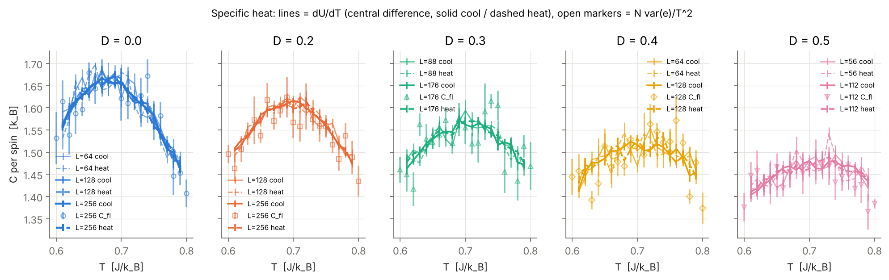

# 보고서: 2D 카이럴 자성체의 두 특성 온도와 VAE 질서변수

의뢰서: [REQUEST.md](REQUEST.md). 작업이 끝날 때마다 이 파일에 덧붙입니다.

## [R-1] 2026-11-21 · 작업 1 · 계산 계획과 예상 소요 시간 (착수 전 검토 요청)

상태: 계획만 확정, 본 계산 대기 중. [V-0]에 따라 검토 후 착수합니다.

### 1.0 계산 전 정리 (대칭과 해석적 어림)

- D=0: O(3) 대칭, 2D이므로 T>0에서 장거리 질서 없음(Mermin–Wagner). 상관 길이는 ξ ∝ exp(2πJ/T)로 자라며 열용량에는 특이점이 없는 교차 봉우리만 있습니다.
- D>0 (Bloch DMI, 정사각 격자): 스핀 회전 대칭은 격자 회전과 묶인 이산 대칭(C4v 꼴)으로 줄어들지만 나선 위상(병진)은 연속 대칭으로 남아 2D에서 T>0 장거리 나선 질서는 없습니다. 남을 수 있는 것은 나선 방향의 이산(Z2/Z4) 질서뿐이고, 이는 작업 4에서 다룹니다. 따라서 작업 1의 열용량 봉우리도 교차로 다룹니다.
- 저온 극한: 스핀당 자유도 2, 고전 등분배로 C → 1. 측정값(봉우리 1.6, 바탕 1.4)과 비교할 기준입니다.
- 규약 확인: `src/kernels.py`는 `prelim/tstar.py`와 같은 국소장 식(Bloch형, d_ij = r̂_ij)을 씁니다.

### 1.1 파일럿 (작은 계산으로 방향 확인)

`src/pilot_tau.py`: T* 근처 에너지의 적분 자기상관 시간 τ_int (스윕 = Metropolis 1 + 과완화 2).

| D | L | T | τ_int(E) [스윕] | C |
|---|---|---|---|---|
| 0 | 128 | 0.70 | 7.2 | 1.75 |
| 0.2 | 256 | 0.68 | 6.9 | 1.61 |
| 0.3 | 128 | 0.70 | 6.0 | 1.55 |
| 0.5 | 112 | 0.72 | 6.9 | 1.57 |

τ_int는 L과 D에 거의 무관하게 약 7 스윕입니다. 이로부터 정한 것:

- 측정 6,000 스윕 ≈ 독립 표본 430개. 요동식 C의 상대 통계 오차는 √(4τ/n) ≈ 7%이고 L에 따라 줄지 않습니다. 반면 U의 오차는 1/L로 줄어서, 큰 L에서는 dU/dT(유한 차분, 0.01 격자)가 요동식보다 정밀합니다. 두 추정량을 모두 쓰고, 다중 히스토그램 재가중도 겹침이 충분한 곳에서 씁니다.
- 0.01 간격에서 이웃 온도 간 에너지 히스토그램의 분리는 L=128에서 약 2σ, L=256에서 약 4.5σ입니다. 큰 L에서는 재가중의 겹침이 부족할 수 있어, 격자점 위의 직접 추정과 비교합니다.

### 1.2 본 계산 설계

`src/run_task1.py`

- 크기 (L/λ ≈ 4, 8): D=0: 64, 128, 256 · D=0.2 (λ=31.8): 128, 256 · D=0.3 (λ=21.6): 88, 176 · D=0.4 (λ=16.5): 64, 128 · D=0.5 (λ=13.6): 56, 112
- 씨앗 1–4.
- anneal 프로토콜: 무작위 → 1.00…0.85 예비 냉각 → 0.80→0.60 냉각 측정(0.01 간격) → 0.50까지 더 냉각 → 0.60→0.80 가열 측정.
- quench 프로토콜(CPC 논문 방식): D=0.3, L=128. T=0.1에서 2,000 스윕 급랭으로 미로 상태를 만든 뒤 같은 배치에서 각 온도로 바로 가열.
- 온도마다 평형 1,000 + 측정 6,000 스윕. 평형 구간을 포함해 매 스윕 에너지를 저장해 표류와 이력을 사후 점검합니다. 원시 시계열은 `data/raw/`(커밋 안 함)에 두고, 요약만 `data/`에 커밋합니다.

**예상 소요 시간**: 스핀·스윕당 약 170 ns(파일럿 실측). 실행 한 벌(anneal)이 약 30.5만 스윕이므로 L=256은 벌당 약 57분, L=128은 약 14분. 전체 48벌(quench 4벌 포함) ≈ 52,000 CPU초, 4코어 병렬로 **약 3.6시간**.

**경위**: 처음에는 이 계획대로 본 계산을 시작했습니다. 그런데 `REVIEW.md` [V-0]과 `CLAUDE.md`(이 브랜치를 만든 뒤 main에 올라옴)를 읽고, 시작 약 6분 만에 모두 중단했습니다. 미완성 출력은 지웠습니다. 지금까지 끝난 것은 1.1의 파일럿(4벌, 각 1분 정도)뿐입니다.

### 교수님 확인 필요

1.2의 계획에는 L=256 실행 12벌(각 약 57분)이 들어 있고, 전체는 4코어에서 약 3.6시간 걸립니다. `CLAUDE.md`의 "몇 시간 이상 걸리는 계산의 착수"에 해당하므로 다음 중 하나를 정해 주세요.

- **A (원안)**: 위 계획 전체. 약 3.6시간.
- **B (축소안)**: L=256을 빼고 D=0은 64, 128, D=0.2는 128만(L/λ ≈ 4). D=0.2의 L/λ ≈ 8은 작업 2(L ≥ 256)로 넘깁니다. 약 1.7시간.
- **C (단계안)**: B를 먼저 돌려 보고한 뒤, 검토를 받아 L=256을 추가합니다.

실행 세션의 추천은 C입니다. 작은 계에서 추정량 세 가지(요동식, dU/dT, 재가중)의 계통 오차 크기를 먼저 확인하면, L=256에 들일 씨앗 수와 스윕 수를 근거를 갖고 정할 수 있습니다.

## [R-2] 2026-11-21 · 작업 1 · 본 계산 착수, H1 판정 기준 (결과 보기 전에 정함)

상태: 계산 진행 중. [V-1]에 따라 A안(48벌, 약 3.6시간)으로 착수했습니다.

### 반영 사항

- [V-1] 4번: `src/run_task1.py`에 저장 항목을 추가했습니다.
  - 모든 D: 각도 평균 전 S(k)를 |k_x|, |k_y| ≤ k_c 영역에서 저장합니다(파수 단위 2π/L). k_c는 6 이상이고, D>0이면 고리 반지름의 2배 이상입니다. D=0의 Ornstein–Zernike 맞춤에 씁니다.
  - D>0: 고리(0.6–1.5 n_q, n_q = L·√2·arctan(D/√2)/2π, `prelim/aniso.py`와 같은 정의)에서 S(k) 가중 ⟨cos4φ⟩와 |⟨e^{2iφ}⟩|를 저장합니다.
- [V-1] 3번: 세 추정량의 차이를 계통 오차로 따로 보고합니다. L=256에서 재가중 겹침(Kish 유효 표본 수)이 부족하면 그 추정량은 빼고, 뺐다고 적습니다.

### H1 판정 기준 (결과를 보기 전에 고정)

**T\*의 정의**

- 대표 추정량은 dU/dT입니다. 0.01 격자 위의 중심 차분에 반폭 0.04 창으로 2차식을 맞춰 봉우리를 찾습니다.
- 한 (D, L)의 T\*는 씨앗 4개 × 냉각·가열의 평균입니다.

**오차**

- σ_stat: 씨앗 간 표준편차/√n. 냉각과 가열을 따로 구한 뒤 평균합니다.
- σ_syst: 다음 세 항목을 제곱합으로 합칩니다.
  1. 추정량 간 반범위: dU/dT, 요동식, 재가중(쓸 수 있을 때)
  2. 창 반폭 0.03–0.05의 반범위
  3. 냉각·가열 차이의 절반
- σ = √(σ_stat² + σ_syst²)

**비교 쌍**

- 각 D>0은 L/λ ≈ 8인 큰 계를 씁니다.
- D=0과의 비교: D=0의 L=128과 L=256 차이가 오차 안이면 D=0 L=256을 기준으로 씁니다. 오차를 넘으면 같은 L끼리 비교합니다(D=0.2와 L=256, D=0.4와 L=128).
- 보조로 L/λ ≈ 4 계에서도 같은 판정을 하고, 두 결과가 다르면 그 사실을 보고합니다.

**판정**

- **지지**: 모든 D ∈ {0.2, 0.3, 0.4, 0.5}에서 |T\*(D) − T\*(0)| ≤ 2√(σ_D² + σ_0²)이고, T\*(D)의 직선 맞춤 기울기가 0에서 2σ 이내.
- **기각**: 어느 D에서든 차이가 3√(σ_D² + σ_0²)를 넘거나, 기울기가 0에서 3σ 넘게 벗어남.
- **미결**: 그 밖의 경우.
- 참고: 예비 결과의 dU/dT 값(0.678–0.725)은 차이가 최대 0.047이고, 4절에 적힌 계통 오차는 약 0.02입니다.

## [R-3] 2026-11-21 · 작업 1 · 열용량 봉우리 T\*: D=0에도 있으나 D에 따라 약간 오름. H1 판정은 미결

상태: 작업 1 완료(48벌). 판정은 [R-2]에서 미리 정한 기준을 그대로 적용했습니다.

### 실행 기록

- **48벌 모두 완료**: anneal 44벌(5개 D × 크기 2–3 × 씨앗 4), quench 4벌.
- **컨테이너 재시작**: 계산 도중 컨테이너가 두 번 재시작됐습니다.
  - 그 뒤로 `src/run_task1.py`는 온도 단계마다 체크포인트를 저장하고, `src/queue_task1.sh`는 끝난 벌을 건너뜁니다.
  - 재시작 시점에 미완성이던 벌은 처음부터 다시 돌렸습니다. 단계 중간에서 이어 돈 벌은 없습니다.
  - 재개 기능을 쓰면 numba 난수 상태를 복원할 수 없어 (씨앗, 단계 번호)로 다시 씨앗을 넣습니다. 그러면 같은 씨앗이라도 끊기지 않은 실행과 비트 단위로 같은 결과가 나오지는 않습니다.
- **실측 소요 시간**: 약 4.5시간(재시작 손실 포함). 예상은 3.6시간이었습니다.
- **재현 절차**: `src/queue_task1.sh` → `src/analyze_task1.py` → `src/summarize_task1.py` → `src/judge_h1.py` → `figures/fig_t1_*.py`
- **커밋한 요약**: `data/task1_summary.json`(벌 종류별 T\*와 씨앗 평균 곡선), `data/task1_h1.json`(판정 수치). 원시 에너지 시계열(`data/raw/`, 약 0.5 GB)은 커밋하지 않았습니다.

### 결과 1: T\* 표 (dU/dT 봉우리, 씨앗 4개 × 냉각·가열 평균)

| D | L | L/λ | T\* | σ_stat | σ_추정량 | σ_창 | σ_이력 | σ_합 |
|---|---|---|---|---|---|---|---|---|
| 0 | 64 | — | 0.6712 | 0.0072 | 0.0040 | 0.0026 | 0.0092 | 0.0126 |
| 0 | 128 | — | 0.6773 | 0.0030 | 0.0075 | 0.0020 | 0.0002 | 0.0083 |
| 0 | 256 | — | **0.6797** | 0.0008 | 0.0093 | 0.0004 | 0.0012 | 0.0094 |
| 0.2 | 128 | 4.0 | 0.6955 | 0.0027 | 0.0031 | 0.0011 | 0.0047 | 0.0063 |
| 0.2 | 256 | 8.1 | **0.6961** | 0.0009 | 0.0041 | 0.0015 | 0.0001 | 0.0044 |
| 0.3 | 88 | 4.1 | 0.6995 | 0.0032 | 0.0012 | 0.0035 | 0.0033 | 0.0059 |
| 0.3 | 176 | 8.1 | **0.7083** | 0.0035 | 0.0052 | 0.0019 | 0.0035 | 0.0074 |
| 0.4 | 64 | 3.9 | 0.7022 | 0.0126 | 0.0035 | 0.0013 | 0.0042 | 0.0138 |
| 0.4 | 128 | 7.8 | **0.7086** | 0.0082 | 0.0060 | 0.0008 | 0.0051 | 0.0114 |
| 0.5 | 56 | 4.1 | 0.7158 | 0.0084 | 0.0129 | 0.0057 | 0.0008 | 0.0164 |
| 0.5 | 112 | 8.2 | **0.7292** | 0.0030 | 0.0118 | 0.0074 | 0.0067 | 0.0158 |

오차 산출 방법 ([R-2]에서 정한 대로):

- **σ_stat (통계)**: 씨앗 간 표준편차/√4를 냉각과 가열에서 따로 구해 평균했습니다. 씨앗이 4개뿐이라 이 값 자체가 약 40% 불확실합니다.
- **계통 오차 세 항목**:
  - σ_추정량: dU/dT, 요동식, 재가중 T\*의 반범위
  - σ_창: 맞춤 창 반폭 0.03–0.05의 반범위
  - σ_이력: 냉각과 가열 T\* 차이의 절반
- **σ_합**: 위 네 항목의 제곱합의 제곱근
- **재가중 사용 여부**: 모든 벌에서 Kish 유효 표본 수가 50 이상이어서 재가중을 빼지 않았습니다. 최솟값은 L=256에서 약 170입니다.

그림: [figures/fig_t1_Tstar.png](figures/fig_t1_Tstar.png) (T\* 대 D), [figures/fig_t1_C.png](figures/fig_t1_C.png) (C(T) 곡선)

### 결과 2: 예비 결과와 비교

| D | 예비 (dU/dT, 씨앗 1) | 이번 (같은 L 또는 L/λ≈8) |
|---|---|---|
| 0 | 0.678 (L=128) | 0.677 ± 0.008 (L=128), 0.680 ± 0.009 (L=256) |
| 0.2 | 0.695 (L=128) | 0.696 ± 0.006 (L=128) |
| 0.3 | 0.704 (L=96) | 0.700 ± 0.006 (L=88), 0.708 ± 0.007 (L=176) |
| 0.4 | 0.699 (L=64) | 0.702 ± 0.014 (L=64) |
| 0.5 | 0.725 (L=64) | 0.716 ± 0.016 (L=56), 0.729 ± 0.016 (L=112) |

- 예비 결과의 dU/dT 값은 모두 오차 안에서 재현됩니다.
- 예비 계산에 적힌 "6차 다항식에서 오는 계통 오차 0.02"는 과대평가였습니다. 0.01 격자에서 직접 구하면 창에 따른 차이가 0.001–0.007입니다.
- 예비 결과 표의 "T\*(요동)" 값(0.707–0.747)은 요동식 추정량의 큰 잡음(아래 결과 4) 때문에 흔들린 것으로 보입니다.

### 결과 3: 이력과 프로토콜

- **이력 없음**: 냉각과 가열의 U(T) 차이는 모든 (D, L)에서 0과 맞습니다. 그림: [figures/fig_t1_hysteresis.png](figures/fig_t1_hysteresis.png) (a).
  - 231개 점의 χ²/n = 1.43입니다. 오차가 씨앗 4개의 표준오차라 t 분포(자유도 3)를 따르므로, 기댓값은 1이 아니라 3입니다.
  - 평균 차이는 스핀당 |ΔU| ≲ 10⁻⁴입니다.
  - T\*의 냉각·가열 차이도 최대 0.013(D=0.5, L=112)으로 σ_합 안입니다.
- **급랭 프로토콜(CPC 논문 방식)**: D=0.3, L=128에서 T\* = 0.7046 ± 0.0015(통계) ± 0.010(창)입니다. 같은 D의 냉각 결과 0.6995(L=88), 0.7083(L=176)과 맞습니다. C(T) 곡선도 겹칩니다. 그림 (b).
  - 이 온도 영역(ξ ≲ 10)에서는 급랭으로 만든 미로가 1,000 스윕 안에 풀려, 급랭 프로토콜이 결과를 바꾸지 않습니다.
  - 단, 논문의 평형 스윕 수는 모르므로 더 짧은 평형에서도 같은지는 확인하지 않았습니다.

### 결과 4: 추정량 비교 ([V-1] 3번)

- **dU/dT**: L이 커질수록 정밀해집니다. L=256에서 씨앗 간 흩어짐이 0.002입니다.
- **요동식과 재가중**: 둘 다 요동식 C의 상대 잡음(온도점당 약 7%)을 물려받습니다. 한 벌의 T\*가 0.61–0.76 사이를 오가고, L이 커져도 나아지지 않습니다.
- 재가중은 겹침이 충분해 유효 표본 수에는 문제가 없지만, 정보량이 요동식과 같으므로 정밀도도 같습니다.
- 그 결과 σ_추정량(0.003–0.013)은 대부분 요동식과 재가중의 통계 잡음입니다. 이 추정량들이 계통적으로 어긋난다는 증거는 없습니다(아래 "판정 기준의 문제" 참고).

### H1 판정 (사전 기준)

**주 판정**: D>0은 L/λ≈8, 기준은 D=0의 L=256. D=0의 L=128과 L=256 차이는 0.0024로 결합 오차 0.013보다 작아 기준으로 L=256을 썼습니다.

| D | ΔT\* = T\*(D) − T\*(0) | 결합 σ | z |
|---|---|---|---|
| 0.2 | +0.016 | 0.010 | 1.6 |
| 0.3 | +0.029 | 0.012 | 2.4 |
| 0.4 | +0.029 | 0.015 | 2.0 |
| 0.5 | +0.050 | 0.018 | 2.7 |

- 기울기: dT\*/dD = 0.094 ± 0.041 (z = 2.3, D>0 네 점). D=0을 포함하면 0.090 ± 0.028 (z = 3.2).
- 사전 기준에서 기울기는 D>0 네 점으로 맞추므로 z = 2.3입니다. 기각선(3σ)은 넘지 않고 지지선(2σ)도 넘지 못해 **미결**입니다.

**보조 판정** (L/λ≈4): 차이의 z = 1.4, 1.8, 1.4, 1.9, 기울기 z = 1.1로 사전 기준상 "지지"입니다. 주 판정과 다릅니다.

**H1 판정: 미결.** H1을 두 부분으로 나누면 다음과 같습니다.

- **(a) 봉우리는 D=0에도 0.7J 근처에 있다: 지지.** D=0에서 T\* = 0.680 ± 0.009이고, 봉우리 모양도 D>0과 같습니다([fig_t1_C.png](figures/fig_t1_C.png)). 봉우리의 존재는 카이럴 구조와 무관합니다.
- **(b) 봉우리 위치는 D에 무관하다: 미결, 사후 분석으로는 기각 쪽.** D=0→0.5에서 T\*가 +0.050(7%) 오르고, 봉우리 높이는 1.67에서 1.48로 낮아집니다.
- 이번 크기 범위(L/λ ≈ 4→8)에서 T\*가 크게 움직이지 않으므로, 어느 판정에서든 T\*는 λ에 맞춰진 양으로 보이지 않습니다.

### 판정 기준의 문제 (검토 요청)

[R-2]의 기준은 σ_추정량을 계통 오차에 넣었습니다. 결과를 보니 이 항은 요동식과 재가중 추정량의 통계 잡음이고, 그래서 결합 오차가 부풀려집니다. 증거는 다음과 같습니다.

- 기울기 맞춤의 χ²/dof가 0.54/2로 1보다 훨씬 작습니다.
- dU/dT 하나만 쓰면 오차가 3–5배 작아집니다.

미리 정한 기준을 사후에 바꾸지 않으려고 판정은 "미결"로 두었습니다. 대신 아래 사후 분석을 따로 표시해 보고합니다.

### 사후 분석 (사전 기준 밖, 참고용)

1. **dU/dT만 쓴 경우**: σ에서 σ_추정량을 빼고 통계·창·이력만 넣었습니다(L/λ≈8).
   - ΔT\* = +0.016 ± 0.002 (z = 7.1), +0.029 ± 0.006 (5.2), +0.029 ± 0.010 (2.9), +0.050 ± 0.011 (4.7)
   - 이 오차로는 T\*가 D에 따라 오른다는 것이 뚜렷합니다.
2. **J_eff = √(J²+D²)로 척도를 맞춘 경우**:
   - 근거: 1D 사슬에서는 국소 스핀 회전으로 Bloch DMI가 J_eff = √(J²+D²)인 Heisenberg 결합으로 정확히 바뀝니다. 2D에서는 두 방향의 회전이 서로 교환되지 않아 정확하지 않습니다.
   - T\*/√(1+D²)와 D=0 L=256 값의 차이: D=0.2에서 +0.003 (z = 1.2), D=0.3에서 −0.001 (z = −0.2)로 작은 D에서는 상승분을 거의 그대로 설명합니다.
   - D=0.4, 0.5에서는 −0.022 (z = −2.4), −0.028 (z = −2.9)로 지나치게 보정합니다.
   - 즉 T\*의 D 의존성은 "에너지 척도의 단순한 증가" 쪽으로 해석할 수 있지만, 2D에서 그 보정은 큰 D에서 √(1+D²)보다 약합니다.
   - 이것이 H1의 "D에 무관"을 어떻게 다듬어야 하는지 시사합니다. 예: "T\*/J_eff(D)가 거의 상수". 다만 가설을 바꾸는 일은 교수님 결정 사항이라 여기서는 관찰로만 적습니다.

### 교수님 확인 필요

1. **H1 판정 방식**: [R-2] 기준의 σ_추정량 항을 그대로 둘지, 사후 분석 1처럼 dU/dT 하나로 판정할지 정해 주세요. 후자를 택하면 H1(b)는 **기각**입니다. T\*는 D에 따라 0.68→0.73으로 오릅니다.
2. **H1 문구 수정 여부**: "T_SRO는 D에 무관" 대신 "T_SRO는 D=0에도 존재하고, D 의존성은 에너지 척도(J_eff) 수준으로 작다"로 다듬을지 정해 주세요. 작업 2(T_q(D))와 작업 3(η)의 비교 기준이 이 문구에 달려 있습니다.

### 다음 단계

작업 2(T_q(D))로 넘어가기 전에 [R-3] 검토를 기다리지 않고, 작업 2의 작은 계산부터 시작할 수 있습니다. 이번 데이터에 저장한 S(k)(각도 평균 전 값, 고리의 ⟨cos4φ⟩)로 다음 두 가지를 먼저 해 보겠습니다.

- D=0, L=256의 ξ_H(T) (Ornstein–Zernike 맞춤)
- D>0에서 S(k) 최댓값이 k=0을 떠나는 온도의 예비 추정

L=512 계산은 착수 전에 예상 시간을 따로 보고하겠습니다.

## [R-4] 2026-11-21 · 작업 1 보강 · H1 수정 문구(O(D²))의 정량 확인: 계획

상태: 계산 진행 중. [V-2]의 교수님 결정과 검토 요청에 따른 항목입니다.

### 추가 계산 (D² 꼴 확인용, [V-2] 요청)

- D=0.1 (λ=63.0): L=256 (L/λ=4.06). D=0.15 (λ=42.2): L=168 (L/λ=3.98).
- 씨앗 1–4, 프로토콜과 스윕 수는 작업 1과 같습니다(anneal, 평형 1,000 + 측정 6,000).
- **예상 소요 시간**: 4코어에서 약 1.4시간(L=256 4벌 약 1시간, 이어서 L=168 4벌 약 25분).
- **판별력 어림**: D=0.2 점에서 직선으로 외삽하면 ΔT\*(0.1) ≈ 0.008이고, D² 꼴이면 0.004입니다. L=256에서 dU/dT 단독 오차는 약 0.0015라 차이는 약 2σ입니다. 결정적이지는 않지만 꼴을 가늠할 수 있습니다.
